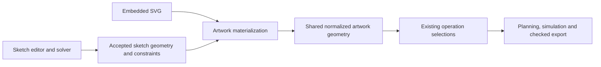

# Artwork sketcher discovery and implementation plan

Status: milestones 1–5 and the selection/tools UX pass complete, 2026-10-11,
qualified on Windows native and Edge/WebGPU on the host described below.
The user selected Arael following the
[feasibility study](artwork-sketcher-feasibility.md). The headless model, explicit
solver adapter, shared CAM geometry boundary, editor, constraint solving and CAM
lifecycle are implemented. See the milestone 5 results for measured limits and
the exact release artifacts exercised.

Add a second artwork source, **Sketch**, alongside **SVG**. A sketch stores
editable geometry, dimensions and constraints; its accepted geometry enters
the same selection, planning, simulation and export workflow as imported SVG.
The first release is a focused 2D sketcher on **both native and browser**.
SVG editing follows separately. These scope choices were confirmed by the user.

## Discovery baseline (before milestone 1)

Paths below are relative to `flat-v-carve/crates/`.

| Existing boundary | Evidence and consequence |
| --- | --- |
| Artwork source types | `cam-core/src/project/v5/mod.rs`, `ArtworkContent`, explicitly anticipates a future Sketch variant. Currently only `Svg(SourceSnapshot)` exists. |
| Common geometry catalogue | `cam-core/src/project/v5/artwork.rs` resolves independently placed items into owner-qualified filled components, contours, centerlines and points. Reuse these operation-facing types. |
| Actual filled-region resolution | `cam-core/src/project/v5/resolve.rs` also imports SVG directly when resolving selected regions. Updating only `item_catalogue` would leave Flat V-carve and Pocket incomplete. |
| Stock initialization | `cam-core/src/project/v5/authoring.rs::page_stock` assumes an SVG page. A sketch needs an explicit frame and new-project policy. |
| Source identity | `ArtworkItem::source_revision` hashes SVG text plus import settings, excluding placement/name. Any content change currently makes old selections unresolved. |
| Editing commands | `cam-core/src/project/v5/commands.rs` supplies import, replace, duplicate, placement and reference-repair commands. SVG replacement deliberately does not repair references automatically. |
| Geometry identity limits | `cam-core/src/contours.rs` derives some IDs using geometry order, including sorted hole indices. Persistent sketch entity IDs alone cannot guarantee persistent CAM selections. |
| Plan freshness | `cam-core/src/sequence.rs` hashes source revisions, placement and scoped machining inputs. `cam-service/src/retained.rs` rejects stale execution/output. Preserve that gate. |
| Shared GUI | `cam-gui` is Rust egui/eframe with wgpu, targeting Windows native and browser WASM. No production React editor exists to extend. |
| Editing lifecycle | `cam-gui/src/app.rs`, `state.rs` and `recovery.rs` separate documents, raw drafts, undo and recovery. Reuse their transaction rules. |
| UI and admission | `cam-gui/src/inspector.rs`, `workspace_ui.rs` and `session.rs` assume SVG, including an explicit SVG-only check in `session::open`. |
| Compute and caches | `cam-gui/src/worker.rs`, `compute.rs`, `session.rs` and `artwork_cache.rs` provide background transport, stale-result handling and catalogue caching. Sketch dragging needs a lightweight solve path. |

The portable document has a 64 MB bound, while the current GUI admission path
has an 8 MB bound. Budget sketch entities, constraints, undo and recovery
explicitly; do not assume the larger core bound applies to GUI sessions.
The workspace also forbids application `unsafe` code. A C++ solver introduces
an integration/build decision rather than being an ordinary Rust dependency.

## First release experience

The artwork collection offers **Import SVG** and **New sketch**, with a source
type badge and an **Edit sketch** action. Editing opens a dedicated orthographic
XY workspace with axes, grid, zoom/pan, drawing tools, dimensions, a constraint
list and solver status. Other artwork and stock can be shown as visual context;
they do not acquire live cross-artwork constraints in this release.

| Area | First release |
| --- | --- |
| Geometry | Points, line/polyline, rectangle as constrained lines, circles and circular arcs; construction toggle. Points initially support construction and constraints; circles supply explicit hole centers. |
| Geometric constraints | Coincident, horizontal, vertical, parallel, perpendicular, tangent, equal length/radius, point on line/circle/arc, midpoint, symmetry and fixed/block. Define supported operand combinations explicitly. |
| Dimensions | Horizontal/vertical distance, point-to-point distance, length, radius/diameter and angle. Driving dimensions change geometry; reference dimensions measure it. |
| Interaction | Select/multiselect, drag free geometry, edit dimensions, delete geometry/constraints, contextual applicable constraints, visible snap/auto-constraint suggestions, undo/redo and Esc cancellation. |
| Feedback | Remaining degrees of freedom, fully constrained state, redundant/conflicting constraints, non-convergence and invalid/degenerate geometry. Diagnose using the backend rather than counting constraints. |
| Completion | Apply valid geometry and return to CAM; Cancel restores the pre-edit item. A valid underconstrained sketch can be applied with its current coordinates. |

Persist accepted auto-constraints as ordinary visible constraints. A snap by
itself must not create an invisible permanent relationship. Solver failure and
conflict are different: failure to converge is not proof of inconsistency.
Never delete user constraints automatically to make a solve succeed.

Later work: SVG node/path editing, SVG-to-sketch conversion, splines/ellipses,
trim/extend/fillet, patterns, parameter expressions, external geometry links,
and FreeCAD file import. FreeCAD is the interaction reference, not a commitment
to reproduce its complete workbench or introduce a 3D feature tree.

## Source and geometry architecture



Introduce a single source-materialization boundary used by catalogue inspection,
selected-region resolution and bounds/stock helpers. CAM operation implementations
should receive their existing region/contour/chain/point inputs; they should not
branch on SVG versus Sketch or invoke the interactive solver.

For the first implementation, use typed output/provenance assembly with
deterministic generated SVG as an internal bridge into the existing importer.
Import explicit faces and named wires separately, then publish each output once.
This reuses supported curve flattening,
polygon normalization, fill rules and error accounting. The sketch remains the
editable source; the generated SVG is derived and is never independently edited.
Provide **Export SVG** and, later, an explicit **Create SVG copy** action.

The bridge needs a provenance map between persistent sketch outputs and importer
IDs. This is a real part of the implementation, not something SVG element IDs
alone solve. If the feasibility fixtures cannot preserve hole identities and
analytic circle centers without duplicate selectable geometry, extract the
existing normalization into a shared typed geometry adapter. Make that choice
in the feasibility milestone; do not add a second CAM normalization algorithm.

Suggested ownership: a `cam-core::sketch` domain module for the saved model,
constraint evaluation, topology and materialization; a separate
`cam-sketch-solver` adapter crate for the selected numerical backend; and
`cam-gui::sketch` modules for editor state, tools, drawing and solve transport.
The core does not depend on the solver adapter. The CLI can inspect, plan and
export accepted sketch geometry without loading an interactive solver. Keep
the editor's render geometry separate from CAM's flattened geometry.

### Sketch model and persistence

Use a solver-independent model, conceptually:

```text
ArtworkContent = Svg(SourceSnapshot) | Sketch(SketchDocument)
SketchDocument = format version + local frame + entities + constraints
                 + accepted parameter values + persistent output identities
```

Entities, points, constraints and output wires/regions have stable IDs. Arcs
retain endpoint identity, center/radius and orientation/branch information.
Construction flags belong to geometry. Annotation layout is presentation data.
Backend handles, matrix indices and library-specific serialized types are not
the saved format.

Recommend an additive schema-5 `kind: sketch` variant with its own
`sketch_version: 1`, consistent with the enum's existing extension point.
Preserve existing SVG wire data and revision hashes. Old applications will
reject the unfamiliar kind; show a clear unsupported-content error rather than
flattening it silently. Do not introduce a general old-job migration as part
of this feature. Revisit a top-level schema change only if the agreed design
actually changes existing document semantics.

Save the accepted numeric geometry with its constraints. Reopening or planning
uses those coordinates and validates their constraints/geometry without choosing
a new solution. Re-solving belongs to an edit action; a solver update must not
reshape a saved job merely because it was opened. Any serialized generated
output is a checked cache, not an independent authority.

Keep an invalid or incomplete edit in the editor draft and recovery envelope.
Apply requires a valid accepted solution; it may remain underconstrained.
An empty new sketch is saveable but provides no machinable geometry. Saving or
leaving with a pending draft follows an explicit apply/discard/retain policy,
never a silent discard. Structurally readable externally edited sketches with
unsatisfied constraints remain inspectable and report a planning blocker for
operations that reference them; do not silently machine an older valid shape.

### Coordinate and topology rules

Sketches use local millimeters, Y up. Existing `Placement` remains the only
mapping to setup coordinates. Default placement is identity. Show dimensions
in local sketch units and make non-unit artwork scale visible in the editor;
for example, a 10 mm sketch dimension at scale 2 produces 20 mm placed geometry.

For the SVG bridge, use an explicit stable page/frame and a fixed offset for
negative local coordinates. Compensate that offset inside materialization; the
importer performs its existing inverse Y flip. The feasibility spike uses a
200 mm page for local `[-100,100]²`; production needs a deliberate supported
envelope or a page-independent normalization entry point. Geometry edits must
never recenter the frame, change placement or resize
stock. New sketches use the current stock size as an initial visual frame when
available. A new empty project can create a sketch before stock is specified;
stock setup remains an explicit machining requirement.

Keep analytic entities through solving. Construction geometry produces no CAM
output. Build wires from explicit endpoint connectivity/coincidence, and check
their evaluated positions against the geometry tolerance. Distinguish solve
residual tolerance, endpoint/topology tolerance, display snapping and CAM curve
flattening tolerance. Never bridge a visible gap simply because the endpoints
fall within the current screen snap distance.

Simple closed loops publish contours and filled regions. Nesting uses an
explicit even-odd policy: nested loops become holes/islands, and disjoint outer
loops remain separate components. Publish each closed boundary and usable chain
once. Open wires provide centerlines, not filled regions. Circle centers use
the existing drill-point representation with their solved analytic coordinates;
helper/constraint points are not automatically drill targets.

Intersecting/overlapping loops, ambiguous branches, zero-length edges and
collapsed radii receive located diagnostics. Keep the draft editable. The first
release does not infer arbitrary planar faces from crossing wires. Check that
solved geometry survives normalization without unreported topology changes.

### References and invalidation

Use separate identities for authored content and published machining geometry.
Constraint-label movement or a construction-only edit changes the saved sketch
but should not invalidate unchanged cutting geometry. Real output changes must
invalidate retained machining. Catalogue caches must also include presentation
changes where labels or grouping change their results. Cache validation against
the authored revision separately: unchanged coordinates do not prove that edited
constraints are satisfied. An invalid current sketch must fail readiness and
retained export even if its coordinates match an older valid result.

Applying a sketch is a typed atomic command that installs the accepted model,
rebuilds its catalogue, evaluates affected references and reports consequences.
One edit session is one outer document undo transaction; gestures and constraint
changes have local undo/redo while the editor is open. Undo restores references
and their revisions with the sketch.

| Edit | Proposed reference behavior |
| --- | --- |
| Dimension/drag with unchanged persistent output topology | Carry the same output references forward using explicit provenance, update source revisions, and invalidate affected plans. |
| Rename, annotation layout, unchanged generated output | Preserve machining identity; refresh relevant presentation. |
| Delete/split/merge, changed region nesting, construction toggle affecting outputs | Retain only provably continuous outputs; report other selections unresolved. No nearest-shape or matching-index repair. |
| SVG replacement | Preserve the existing conservative replacement behavior. |
| Manual starts and tabs after changed geometry | Leave affected anchors unresolved in v1 unless the existing exact binding remains valid. Do not assume an old perimeter fraction represents the same user intent. |

Persistent output topology includes region membership and hole identity, not
just the set of entity IDs. Reordering holes spatially is a required regression
case because the existing catalogue sorts them geometrically.

## Solver discovery and recommendation

The [executed feasibility study](artwork-sketcher-feasibility.md) now recommends
Arael for the next implementation milestone, giving substantial weight to its
Rust/native/WASM fit. The following table preserves the initial candidate survey;
use the study for pinned versions, measured behavior and remaining limits.

| Candidate | Evidence | Project fit and remaining check |
| --- | --- | --- |
| FreeCAD PlaneGCS | Upstream exposes constraints, DOF/conflict/redundancy diagnostics and temporary dragging constraints; its header carries LGPL-2.1-or-later. [Upstream API](https://github.com/FreeCAD/FreeCAD/blob/main/src/Mod/Sketcher/App/planegcs/GCS.h) | Leading behavioral reference. Extraction, dependency versions, build packaging and native/browser consistency need qualification. |
| PlaneGCS WASM wrapper | A C++/WASM wrapper exposes primitives and constraints to browser/Node clients. [Wrapper source](https://github.com/Salusoft89/planegcs) | Demonstrates a browser route, not direct compatibility with this Rust WASM module. Audit its FreeCAD revision and wrapper coverage. |
| Arael sketch solver | Rust sketch solver/editor, MIT licensing, and an egui/eframe browser implementation are documented. [Project](https://github.com/harakas/arael) | Especially close to this application's stack. Qualify constraint satisfaction, diagnostics, drag stability, dependencies and maintenance before choosing it. |
| EZPZ | MIT Rust solver with a WASM exercise crate and APIs for freedom analysis. [Project](https://github.com/KittyCAD/ezpz), [API source](https://github.com/KittyCAD/ezpz/blob/main/ezpz/src/lib.rs) | Reserve candidate if the initial pair falls short. Its API separates solving from more expensive analysis, which fits drag versus structural-edit workloads. |
| SolveSpace/libslvs | A solver library interface is published under GPLv3. [Official library page](https://solvespace.com/library.pl) | Credible alternative, but its license and integration choices need to fit the project's distribution plans. |

Compare **PlaneGCS and Arael** first using the same neutral model and fixtures.
Prefer Arael's stack fit when the required correctness/platform contract is met;
closer FreeCAD behavior alone does not justify PlaneGCS's integration cost.
Keep the boundary small:
inputs, initial/accepted values, drag targets and budgets in; solved values,
residuals, status, DOF and implicated IDs out. Ship one qualified backend on both
platforms rather than maintaining different solver behavior per platform.

For PlaneGCS, evaluate a native C++ adapter and a separately loaded WASM module
in the browser. A native helper process can preserve the Rust unsafe-code policy;
an in-process FFI approach would require an explicitly scoped boundary decision.
Using the same pinned solver source is more important than using identical
transport. Account for extra runtime artifacts, offline hosting and reproducible
Windows/browser CI builds. Confirm third-party distribution requirements before
adoption; no project license was found in the inspected repository files.

Use warm starts and temporary drag targets. Reject stale replies using sketch,
document and request revisions. A slow solve must not block drawing or wait
behind a long CAM plan. Coalesce pointer events; budget/cancel solves, and
perform more expensive diagnostics after structural edits or pointer release.
The existing full-scene compute request is too broad for every mouse move.

Independently evaluate required constraints and geometry before accepting a
backend's result. Keep driving constraints mandatory; only drag preferences are
soft. Preserve branch/orientation continuity where possible and report failed
or flipped results rather than silently accepting an unexpected configuration.

## Delivery sequence and acceptance

| Milestone | Deliverable | Acceptance gate |
| --- | --- | --- |
| 0. Feasibility and decisions | Neutral fixture/model harness; PlaneGCS/Arael comparison on Windows and browser; SVG bridge/provenance experiment; pinned backend and packaging decision. | Same constraints and solution branch on both targets within stated tolerance. Conflict, redundancy, underconstraint and cancellation are demonstrated. Hole-ID reorder and analytic-center cases prove the chosen materialization route. |
| 1. Headless sketch artwork | Model/version, validation, materializer, commands, semantic revisions, persistent outputs and new-content admission. | A hand-authored sketch job saves/reopens and reaches existing Profile, Pocket/Flat V-carve, Drag knife and Drill paths. SVG fixtures preserve their existing behavior. Empty/invalid sketches remain inspectable. |
| 2. Drawing workspace | New/Edit sketch, canvas, primitive tools, construction geometry, snapping, selection, local undo, apply/cancel and recovery. | Create a plate outline and holes entirely in-app on both platforms, apply, pick geometry and save/reopen. No placement or stock drift. |
| 3. Constraints and interaction | First-release constraint set, driving/reference dimensions, drag solving, status and contextual diagnostics. | Fully constrain a bracket; resize it through dimensions; identify/remove a conflicting constraint; drag an underconstrained sketch; recover from failure without losing work. |
| 4. CAM lifecycle | Atomic reference updates, topology-change reporting, anchors, freshness, undo/redo, SVG export and mixed-source jobs. | Dimension edits preserve provably continuous selections and stale the old plan. Deleted/split outputs and changed anchors require repair. Undo restores the former geometry/references. Mixed SVG/sketch operations plan and export through existing gates. |
| 5. Qualification | Focused regressions, native/browser UI scenarios, performance/resource measurements and user documentation. | Successful end-to-end saved-job roundtrip and checked export on both platforms; bounded failure paths; release artifacts include all solver dependencies. |

Milestone 0 measures cold load, warm solve, diagnostics, serialization and memory
for approximately 25, 100 and 500 entity sketches with varying constraint density.
Provisional interaction target: p95 warm solve below 50 ms for a representative
100-entity/200-constraint sketch on named test hardware, with responsive UI even
when solving exceeds that target. Confirm budgets from measurements rather than
claiming a performance guarantee from upstream examples.

The fixture set includes a dimensioned rectangle, a symmetric bracket with equal
holes, a tangent line/arc slot, nested islands, an open knife wire, construction
geometry, redundant and contradictory dimensions, degeneracies and difficult
initial guesses. Add translated/rotated/scaled placement, negative coordinates,
small and large dimensions, rapid edits with out-of-order replies, draft recovery,
save failures and undo across apply.

For source equivalence, compare normalized regions, contour/chain geometry,
analytic drill centers, bounds and source error budgets against equivalent SVG
fixtures. Compare resulting machining under equal settings within declared
tolerances; separate artwork IDs need not yield byte-identical fingerprints.
Constraint residual checks do not replace CAM's existing geometry/output checks.

## Decisions to carry into implementation

Confirmed: focused 2D sketcher, SVG editing later, native and browser together,
and a common downstream artwork contract.

Proposed defaults: dedicated sketch workspace; valid underconstrained sketches
allowed; saved accepted coordinates; deterministic source materialization;
provenance-based selection continuity; conservative manual-anchor repair;
additive sketch content version; no cross-sketch constraints in v1.

The first implementation milestone must settle the backend, packaging/license
fit, materialization/provenance route and measured resource budgets. These are
bounded engineering decisions with acceptance fixtures, not reasons to expand
the first release into a complete FreeCAD workbench.

Milestone 0 now has an [isolated, reproducible harness](../../flat-v-carve/experiments/sketcher-feasibility/README.md).
Its findings favor Arael with independent residual validation and bounded
refinement, plus a typed materialization/provenance layer over existing geometry
normalization. Plain SVG hole indices cannot preserve sketch selections, and the
SVG page envelope must explicitly support negative local coordinates. Production
topology discovery, apply/undo/export integration and native in-process
cancellation remain implementation gates; the feasibility prototype does not
change application behavior.

## Milestone 1 implementation

`cam-core::sketch` owns the solver-independent `SketchDocument` (version 1).
Schema 5 admits an additive `ArtworkContent::Sketch` variant. It saves local
millimetres with Y up, a fixed page envelope, entities, constraints and explicit
ordered wires. Entity, wire and constraint IDs are caller-owned persistent IDs;
do not recycle them when deleting and recreating geometry. Construction geometry
and standalone points are omitted from CAM. Circles publish exact drill centers.
Closed wires derive nesting, holes and islands through strict region validation;
open wires publish centerlines. Unwired edges, open joins, mixed construction
wires, crossings and collapsed topology prevent materialization.

Structural admission is separate from numerical and machining readiness. Empty
and numerically unsatisfied drafts save and reopen without solving. Invalid
operands, unknown versions, duplicate IDs and excess budgets are rejected.
Limits are 500 entities, 2,000 constraints, 500 wires/total wire edges, 80-byte
identifiers, 2 MB per sketch and coordinates within ±100,000 mm. The independent
driving-constraint residual threshold is 1e-6 mm; angular residuals are converted
to linear displacement. Reference dimensions report measurements and do not drive.
Underconstrained solutions are allowed. The constraint vocabulary covers endpoint
coincidence, horizontal/vertical, parallel/perpendicular, equal length/radius,
line-to-supporting-circle tangency, point-on-line/circle, midpoint, symmetry,
distance and signed horizontal/vertical dimensions, length, radius, angle and
explicit fixed targets. Arc-end contact is a separate coincidence constraint.

`cam-sketch-solver` pins Arael to
`18d86e1fda91814a4a42d00001f3e8461c638bb4`. Native Rust and browser WASM run the
same adapter. The upstream MIT notice is retained in
`crates/cam-sketch-solver/licenses/arael-MIT.txt`.
`solve`/`solve_with_cancel` return a candidate, independent residuals,
acceptance status, DOF when available and solver provenance. Solving never changes
the input job or saved model. Three graduated LM stages and one refinement allow
at most 208 iterations. Cancellation is cooperative between stages; there is no
hard wall-clock bound or mid-factorization cancellation. The current diagnostics
identify violated constraints, not a minimal conflicting/redundant constraint set.
Acceptance here means numerical acceptance; CAM topology still passes through
materialization. JSON clients use `solve_json` or the WASM `solveSketch` export.

`v5::artwork::materialize_item` serves both catalogue inspection and filled-region
planning. It uses the existing SVG flattener, precision grids and contour machinery.
Arcs use the shared center-based sampler, avoiding endpoint-to-center ambiguity
near semicircles. The generated SVG bridge is transient. Persistent output IDs are
`chain-{wire}`, `contour-{wire}`, `region-{outer-wire}` and `center-{circle-entity}`.
Provenance records ordered edges, entity kinds, closure, ancestry and component
hole membership; it never matches by proximity, tessellation order or hole index.
The fixed frame supports negative coordinates without changing stock or placement.

`commands::add_sketch` and `commands::apply_sketch` return atomic document outcomes.
Apply advances currently bound selections only when explicit provenance agrees.
Stale, missing and changed-topology references remain unresolved. Anchors advance
only if their entire source boundary and prior fingerprint are unchanged. An
edited anchor boundary requires reassignment. Solver requests and candidate
application remain separate calls; the future editor must track draft/request
revisions and discard obsolete replies before applying a candidate.

Sketch source revisions exclude labels, reference dimensions, constraints and
construction-only content. Exact published coordinates, frame, connectivity and
interpretation affect the revision. Readiness and retained machining identity
separately reject unsatisfied constraints, including constraint-only edits with
unchanged coordinates. Inspection caches use the full authored revision so those
edits cannot reuse an earlier valid catalogue. SVG serialization and source hash
behavior remain unchanged. Native/browser job admission accepts saved sketches.

The loadable [sample job](../../flat-v-carve/fixtures/v5/sketch-job.json) contains
a dimensioned plate, a hole and an open knife wire, with no operations assigned.
The [standalone model](../../flat-v-carve/fixtures/sketch/rectangle.json) is also a
headless solve fixture. From `flat-v-carve`, for example:

```powershell
Get-Content fixtures/sketch/rectangle.json -Raw | cargo run -p cam-sketch-solver --example solve
cargo test -p cam-core --test sketch_artwork
cargo test -p cam-sketch-solver
cargo test -p cam-service --test retained sketch_constraint_only_edit_cannot_authorize_retained_output
cargo test -p cam-gui artwork_cache::tests --lib
cargo check --target wasm32-unknown-unknown -p cam-sketch-solver -p cam-gui
```

The core acceptance fixtures exercise Profile, Flat V-carve, Pocket, Drag knife
and Drill through existing planners, including checked Pocket/Drill output,
SVG geometry equivalence, save/reopen, frame placement, hole reorder, invalid
drafts, selection preservation and conservative anchor repair. The retained-service
fixture prepares checked sketch output and then refuses a constraint-only edit.
The shared GUI test verifies saved-sketch admission and invalidates cached readiness.

The actual-browser smoke test is
`crates/cam-sketch-solver/tests/browser.html`. Build the crate for
`wasm32-unknown-unknown`, run wasm-bindgen-cli **0.2.128** with `--target web`,
serve its generated files under `pkg/` beside that HTML and a copy of
`fixtures/sketch/rectangle.json`, and open the page on localhost. Six checks cover
the constrained fixture, dimension edits, residuals, roundtrip, contradictions and
invalid operands. The production adapter passed these checks in the in-app browser.
This is headless qualification; no New/Edit sketch controls or sketch canvas ship
in milestone 1. The next milestone can build that UI on the saved model and APIs.

## Milestone 2 implementation

The shared egui workspace now provides New/Edit sketch, line/polyline, rectangle,
circle, three-point arc and reference point tools; construction geometry; visible
snapping; wire selection/multiselection; free-wire translation; deletion; local
undo/redo; Apply/Cancel; and draft recovery. Apply uses the milestone 1 validation,
materialization and provenance commands. Native/browser use the same editor code.
The [GUI guide](../../flat-v-carve/crates/cam-gui/README.md#sketch-artwork) describes
the controls; [GUI architecture](gui-architecture.md#sketch-artwork-workspace)
records ownership, recovery limits and transaction behavior.

Milestone 2 introduced whole-wire selection and protected saved constraints.
Milestone 3 extends it with individual point/body operands and solver-driven
deformation. Random persistent IDs prevent reuse across editing sessions.

Acceptance coverage includes native egui pointer-driven outline/hole drawing,
geometry validation failures, stock/placement preservation, local/document undo
isolation, recovery, save/open and initial/compact canvas layout. The browser
scenario `web/sketch-scenario.mjs` drives real pointer/keyboard input through every
drawing tool, wire dragging, local undo/redo, rejected and accepted Apply, Profile
contour selection, download/open, Edit/Cancel, recovery/reload and compact layout.
Native rendering is captured with `--features ui-review` and the `sketch` panel.

## Milestone 3 implementation

The native/browser editor now authors and edits the supported geometric constraints
and driving/reference dimensions, including individual fixed endpoints/centres.
The constraint panel selects ordered operands, displays dimensions on the canvas,
lists residuals and locates failed constraints. Reference measurements follow solved
geometry. Unsatisfied edits remain repairable without replacing the previous geometry.

Solving and dragging run in a dedicated disposable process/Worker. Requests carry
draft revision and request identity; drag targets coalesce, stale responses are
discarded, and a ten-second timeout terminates stalled work. Independent numerical
validation and authored-model checks guard every accepted result. Wire joins are
mandatory constraints. Soft cursor targets yield to driving dimensions. Drag release
commits one local undo transaction; Escape restores the gesture baseline. Apply
continues through the shared topology/provenance layer as one document transaction.

Diagnostics report DOF, residuals, exact duplicates, rejected candidates, worker
failures and drag limits. They do not claim minimal conflicting sets or general
redundancy detection. Solver work never grants machining/export authority.
Recovery saves unfinished constraint text and re-solves restored geometry.

Qualification commands: `cargo test -p cam-sketch-solver`,
`cargo test -p cam-core --test sketch_artwork`, `cargo test -p cam-gui --tests`, and
`node crates/cam-gui/web/smoke.mjs --sketch-constraints --browser=edge` after the
browser build. The native process fixture is `tests/sketch_worker.rs`; the native
render review accepts the `sketch-constraints` panel. The browser offline manifest
and packaging include the dedicated worker, and both packages ship Arael's MIT notice.

## Milestone 4 implementation

Implemented the CAM lifecycle on the shared native/browser app:

- Atomic sketch Apply returns a typed impact report alongside the changed job
  and current reference diagnostics. It identifies added, removed and changed
  topology outputs; preserved selections; changed start/tab boundaries; and
  references that were already unresolved. It never infers a replacement by
  proximity. The inspector provides direct repair navigation.
- Dimension edits with continuous provenance advance selected geometry to the
  new source revision. Manual starts and tabs advance only when the entire source
  boundary and prior binding are unchanged. Deleted or split outputs and changed
  component membership stay unresolved until explicitly selected again.
- Apply invalidates prepared output and is one document undo transaction. Undo
  and redo restore model and references together. Retained output rejects an old
  plan after a geometry edit, independently of what the GUI reports.
- Export artwork SVG writes a fixed-frame millimeter geometry snapshot through
  the existing file ports. Filled holes/islands and open wires survive; curves
  use the shared CAM tessellation. Isolated circles retain SVG circle elements;
  circles in compound regions become paths and lose their analytic drill marker
  in the exported file. Constraints, construction geometry, placement and stable
  selection identities remain in the editable job JSON. Original SVG bytes are
  retained when exporting an SVG source. Export does not mark the job saved.
- `fixtures/v5/sketch-lifecycle-job.json` combines SVG and sketch contours in one
  Profile operation and retains a separate SVG knife operation. Service coverage
  generates and prepares it, rejects stale output after resizing, and checks
  restoration of the original machining identity.

Validation includes sketch topology/provenance and SVG roundtrip regressions,
native Apply/undo/redo and anchor repair, the native solver process, and the real
browser `--sketch-lifecycle` scenario. The browser scenario resizes a driving
dimension through Arael, applies/reports/repairs it, exercises document undo/redo,
downloads checked G-code and compares its SHA-256, retries a failed SVG save,
and saves/reopens the mixed-source editable job. Native render review supports
`sketch-impact`. Release/performance qualification is recorded below.

## UX pass and milestone 5 qualification

The editor now uses the same ordered edge/point selection with its optional lists
open or closed. Shift-click is additive; double-click selects a complete wire;
empty-space dragging provides contained/crossing box selection. Geometry list
selection and canvas selection are synchronized. Complete-wire actions reject
partial selection with a useful message instead of silently broadening the edit.
The left tools panel exposes drawing, constraints and dimensions, with FreeCAD
key sequences, prefix hints and text/IME focus protection. Optional geometry and
constraint/dimension panels preserve selection and the active tool. Canvas
dimension labels open their value form on double-click. Artwork rows reopen
sketches by double-click or context action; the inspector's Edit sketch button
is directly under the artwork heading.

Qualification uses the normal release executable (without `ui-review`) for real
OS input, solver child processes, native Open/Save dialogs, saved-job roundtrip,
and checked output. Browser scenarios run the production WASM app and its actual
Workers in isolated Edge profiles. `--sketch-ux` covers the revised interactions
and injected solver failure/retry; the drawing, constraint and lifecycle scenarios
remain separate regression gates. Screenshots and downloaded/saved files belong
under `flat-v-carve/artifacts/sketch-m5` and `artifacts/gui/browser-smoke`.

`scripts/qualify-sketch-native.mjs` measures the production executable's solver
mailbox. Browser `--sketch-performance` uses qualification-only instrumentation
around the same production `solve_sketch_request` WASM entry point. Neither is
native UI acceptance. Each fixture runs a cold solve and 21 incremental warm
dimension edits at 24, 100 and 500 entities. The 100-entity fixture has 200 explicit
constraints (175 driving, 25 reference) plus 100 implicit wire joins. Results
include end-to-end wall latency, serialized request/reply sizes, native child
working set or WASM linear memory, cancellation/termination, oversize rejection
and retry. Browser compute time and a main-thread heartbeat are recorded too.
These structured rectangle workloads establish a reproducible baseline rather
than a guarantee for arbitrary dense or conflicting sketches.

### Qualification results — 2026-10-11

Milestone 5 passed on Windows build 26200, AMD Ryzen 9 8945HS (16 logical CPUs,
65.3 GB installed RAM), and Edge 155.0.4283.45 using WebGPU on NVIDIA Ampere.
Other operating systems and browser engines were not qualified in this run.

The final release executable SHA-256 is
`a4f1421589b7924c1d91947b942601816ea1e019b812d68dfdf4bbac792d11f1`.
It was launched normally from an isolated copy of the native distribution, with
no `ui-review` arguments or simulated file ports. Real Windows input exercised
saved-sketch reopening by double-click, solver-backed dragging, Cancel,
canvas dimension editing from 20 to 25 mm, Apply, document undo/redo, explicit
start-anchor repair, regeneration, checked G-code export, SVG export, and native
Open/Save dialogs. The saved mixed-source job reopened after another normal
launch with its 25 mm dimension, 14 constraints, two profile selections and
repaired start reference intact. Three normal launches succeeded during the UX
qualification: the initial drawing/selection/undo session used the preceding
build; the two final-build sessions covered reopening, dragging and the complete
CAM lifecycle. No application-error dialog or panic log appeared in these runs.

The editor reported an intentionally terminated native solver child as
"Solver process exited; retry Solve", retained the draft, and successfully
retried in a fresh child. The browser UX scenario likewise injected a worker
failure and recovered through the real Solve control. Native multi-key shortcut
completion is covered by the shared egui input tests and browser UI scenario;
the slower OS automation is not evidence for timing-sensitive key sequences.

The native checked-output dialog and saved 4,631-byte program have the same
SHA-256: `8aa9d41aa8dd9fc7a23c0c4f453ffad9b8a68c780ccdfea5fe39ac04ba4ce38d`.
The editable job JSON was separately checked for the saved dimension, unchanged
stock/SVG source, persistent contour identity and repaired anchor revision.

All four browser UI scenarios passed on the final production WASM build:
`--sketch-ux`, `--sketch`, `--sketch-constraints`, and `--sketch-lifecycle`.
They cover optional-list selection, shortcuts and text focus, drawing and
construction geometry, constrained dragging, driving/reference dimensions,
conflict recovery, compact layouts, saved/recovered drafts, mixed-source CAM
references, anchor repair, and exact checked-output download bytes. Browser
evidence reported no console errors. The packaged WASM/JS and all seven offline
manifest assets match the served build; the sketch worker and Arael license are
included in the release distributions. Solver dependencies are linked into the
native executable/WASM module, with no separately installed solver required.

| Entities | Native cold ms | Native warm p95 ms | Browser cold ms | Browser warm p95 ms |
| --- | ---: | ---: | ---: | ---: |
| 24 | 22.3 | 26.2 | 71.6 | 5.2 |
| 100 | 33.2 | 30.8 | 59.2 | 9.9 |
| 500 | 45.7 | 53.3 | 62.0 | 43.5 |

The 100-entity warm workload meets the provisional 50 ms target on this host.
Native solver working sets were 12.3–13.1 MB (peaks 12.8–18.7 MB); browser WASM
linear memory was 3.7–8.2 MB. These are different resource measures, not a native
versus browser total-memory comparison. The native GUI after the CAM workflow
used 411.9 MB working set, peaking at 424.5 MB; its CAM worker was separate.
The largest fixture serialized 180,839 request bytes and 268,975 reply bytes.
The browser's 16 ms heartbeat had a maximum observed gap of 18.7 ms while solving.
Browser cold measurements use a warm HTTP/WASM cache. Native cancellation killed
and reaped an active solver child in 4.2 ms; the browser measurement only times
the `terminate()` call and does not establish stopped-CPU latency. Both rejected
oversized requests and accepted a subsequent retry. Model/transport limits and
undo budgets also have focused regression coverage; arbitrary worst-case solver
latency and long-duration leak behavior are not established by this short run.

Validation: 235 GUI library tests passed; the final focused sketch rerun passed
20 tests, core sketch artwork 16, solver 10, native process worker 1, and retained
sketch-output regressions 2. Workspace Clippy passed with warnings denied, and
format/diff checks passed. Broader workspace and GUI integration runs were
stopped during unrelated long-running CAM tests, so this is not a claim that the
entire workspace test suite completed.

Reproducible evidence (paths relative to `flat-v-carve/`):

- `artifacts/sketch-m5/qualification-results.json`: verified build hashes,
  packaging, saved-file checks, native UI coverage, and performance summary.
- `artifacts/sketch-m5/native-performance.json`: raw native timing/resource samples.
- `artifacts/sketch-m5/native-{selection,drag,worker-failure,dimension25,impact,checked,reopened}.png`:
  normal-app screenshots; `native-checked-ui.txt` retains the export report.
- `artifacts/sketch-m5/native-lifecycle.job.json`, `native-sequence.ngc`, and
  `native-sketch.svg`: files saved through the real native dialogs.
- `artifacts/gui/browser-smoke/2026-10-11T18-24-41.452Z` (UX),
  `2026-10-11T18-25-04.566Z` (drawing), `2026-10-11T18-25-43.774Z` (constraints),
  `2026-10-11T18-26-58.271Z` (CAM lifecycle), and
  `2026-10-11T18-28-40.312Z` (performance): browser evidence and saved outputs.

The user-facing workflow, shortcuts, dimensions, save/reopen instructions and
limits are documented in `crates/cam-gui/README.md`, under **Sketch artwork**.
